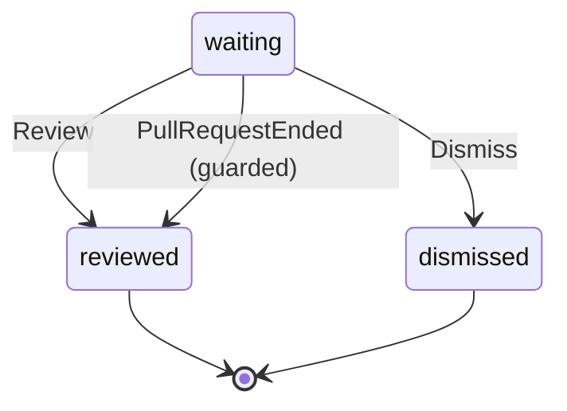

# ArtifactReview

Written by `scripts/machines.mjs` from `ArtifactReviewMachine` in `packages/domain/src/artifact.ts`. Do not edit it by hand: change the machine and run `pnpm docs:machines`.

Its state is in the `review` field.

| State | Meaning |
| --- | --- |
| waiting | Made or changed by a hob, and not reviewed yet |
| reviewed | You reviewed it, or GitHub reported its pull request merged or closed |
| dismissed | You chose not to review it |

| Event | From | To | Guarded |
| --- | --- | --- | --- |
| Review | waiting | reviewed | no |
| Dismiss | waiting | dismissed | no |
| PullRequestEnded | waiting | reviewed | yes |
