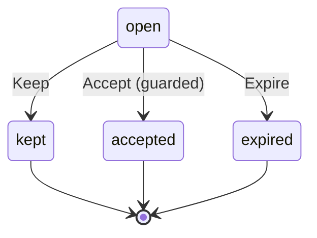

# CampSuggestionState

Written by `scripts/machines.mjs` from `CampSuggestionStateMachine` in `packages/domain/src/camp-suggestion.ts`. Do not edit it by hand: change the machine and run `pnpm docs:machines`.

Its state is in the `state` field.

| State | Meaning |
| --- | --- |
| open | Offered in the chat, with Make a camp and Keep in chat |
| kept | You kept the chapter in the chat; it is never offered again |
| accepted | The chapter moved into a camp |
| expired | Its chapter was merged away or its chat closed, so it is no longer offered |

| Event | From | To | Guarded |
| --- | --- | --- | --- |
| Keep | open | kept | no |
| Accept | open | accepted | yes |
| Expire | open | expired | no |
