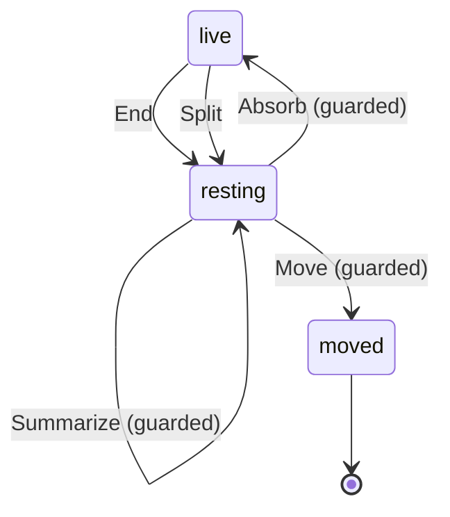

# ChapterState

Written by `scripts/machines.mjs` from `ChapterStateMachine` in `packages/domain/src/chapter.ts`. Do not edit it by hand: change the machine and run `pnpm docs:machines`.

Its state is in the `state` field.

| State | Meaning |
| --- | --- |
| live | The thread's current topic: new messages join it, and its runtime sessions are resumed |
| resting | An earlier topic: it takes no new messages, and its sessions are never resumed |
| moved | Moved into a camp; the thread keeps it as a stub that links there |

| Event | From | To | Guarded |
| --- | --- | --- | --- |
| End | live | resting | no |
| Split | live, resting | resting | no |
| Absorb | resting | live | yes |
| Absorb | resting | resting | no |
| Move | resting | moved | yes |
| Summarize | resting | resting | yes |
