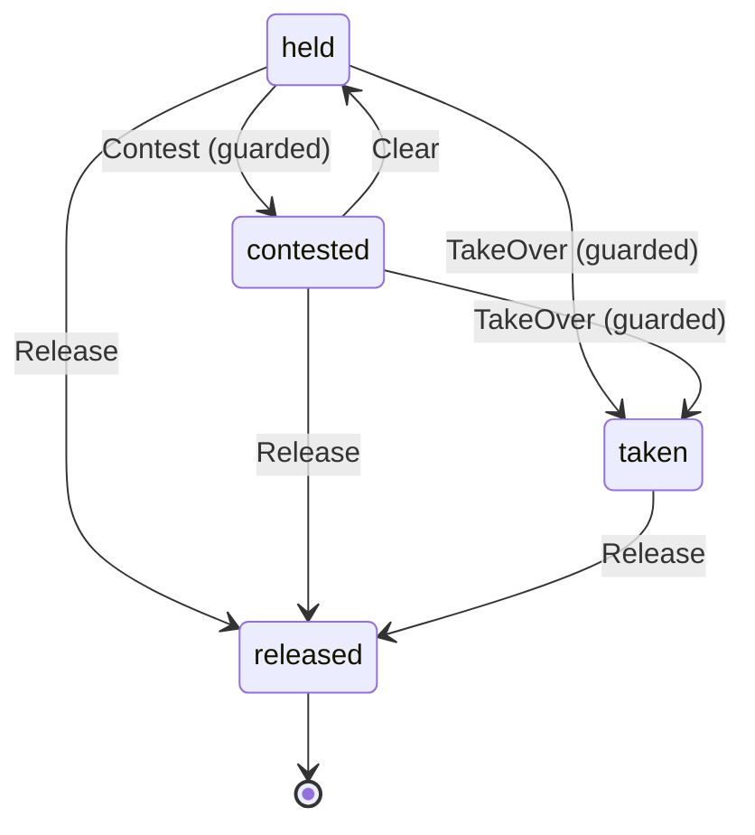

# Claim

Written by `scripts/machines.mjs` from `ClaimMachine` in `packages/domain/src/claim.ts`. Do not edit it by hand: change the machine and run `pnpm docs:machines`.

Its state is in the `state` field.

| State | Meaning |
| --- | --- |
| held | The Task holds it, and no other open claim clashes with it |
| contested | Another Task's open claim on the same path or branch clashes with it; neither Task is stopped |
| taken | You took it over from its Task: it is yours, and the hub refuses its hob's writes to it until the Task ends |
| released | Its Task ended; a released number is never handed out again |

| Event | From | To | Guarded |
| --- | --- | --- | --- |
| Contest | held | contested | yes |
| Clear | contested | held | no |
| TakeOver | held, contested | taken | yes |
| Release | held, contested, taken | released | no |
