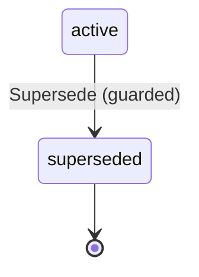

# DecisionState

Written by `scripts/machines.mjs` from `DecisionStateMachine` in `packages/domain/src/decision.ts`. Do not edit it by hand: change the machine and run `pnpm docs:machines`.

Its state is in the `state` field.

| State | Meaning |
| --- | --- |
| active | It holds: the context pack carries it, and the sheet shows it as decided |
| superseded | It no longer holds: kept and shown crossed out, never in the pack |

| Event | From | To | Guarded |
| --- | --- | --- | --- |
| Supersede | active | superseded | yes |
