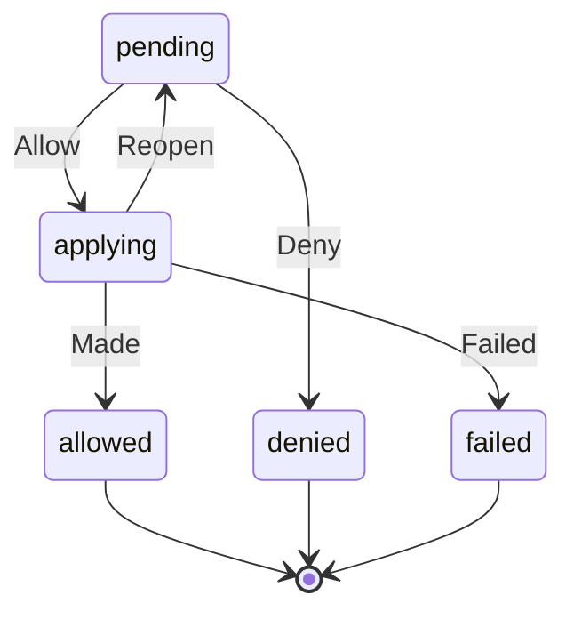

# HobProposalRow

Written by `scripts/machines.mjs` from `HobProposalRowMachine` in `packages/domain/src/hob-proposals.ts`. Do not edit it by hand: change the machine and run `pnpm docs:machines`.

Its state is in the `state` field.

| State | Meaning |
| --- | --- |
| pending | It waits for you to allow or deny it |
| applying | You allowed it and the hub is making it; a stopped hub checks it against the hob first |
| allowed | What it proposes was made |
| denied | You said no, so nothing was done |
| failed | You allowed it and the hub could not make it, with why |

| Event | From | To | Guarded |
| --- | --- | --- | --- |
| Allow | pending | applying | no |
| Deny | pending | denied | no |
| Made | applying | allowed | no |
| Failed | applying | failed | no |
| Reopen | applying | pending | no |
