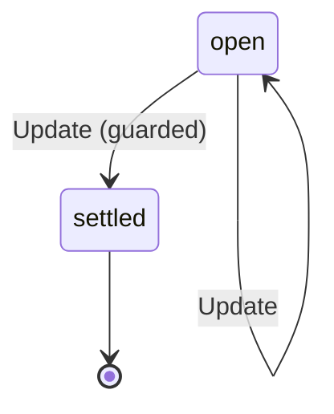

# HobProposal

Written by `scripts/machines.mjs` from `HobProposalMachine` in `packages/domain/src/hob-proposals.ts`. Do not edit it by hand: change the machine and run `pnpm docs:machines`.

Its state is in the `state` field.

| State | Meaning |
| --- | --- |
| open | A row waits for you, or the hub is making one you allowed |
| settled | Every row is decided, and the manager was told how |

| Event | From | To | Guarded |
| --- | --- | --- | --- |
| Update | open | settled | yes |
| Update | open | open | no |
