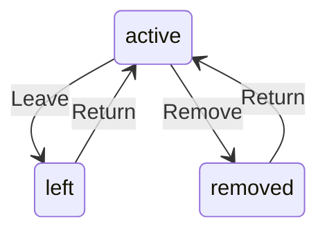

# Member

Written by `scripts/machines.mjs` from `MemberMachine` in `packages/domain/src/thread-member.ts`. Do not edit it by hand: change the machine and run `pnpm docs:machines`.

Its state is in the `state` field.

| State | Meaning |
| --- | --- |
| active | In the thread: reads it, is counted among its members and can be mentioned |
| left | Left on their own, as a retired hob does; comes back with Return |
| removed | Taken out by another member; only adding them again brings them back |

| Event | From | To | Guarded |
| --- | --- | --- | --- |
| Leave | active | left | no |
| Remove | active | removed | no |
| Return | left, removed | active | no |
