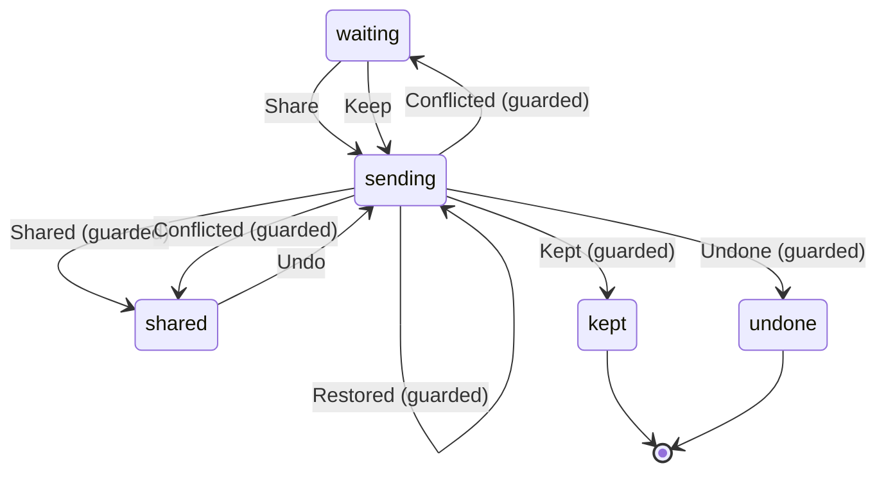

# MemoryShare

Written by `scripts/machines.mjs` from `MemoryShareMachine` in `packages/domain/src/memory-shares.ts`. Do not edit it by hand: change the machine and run `pnpm docs:machines`.

Its state is in the `state` field.

| State | Meaning |
| --- | --- |
| waiting | It waits for your review in the Inbox; nothing is written |
| sending | The hub is writing what `pending` records, and finishes it after a restart or an outage |
| shared | It is in the shared memory, and you can undo it |
| kept | You kept it private: it is in the hob's own memory only |
| undone | You took it back: the shared page is as it was, and the hob keeps the page itself |

| Event | From | To | Guarded |
| --- | --- | --- | --- |
| Share | waiting | sending | no |
| Keep | waiting | sending | no |
| Undo | shared | sending | no |
| Restored | sending | sending | yes |
| Shared | sending | shared | yes |
| Kept | sending | kept | yes |
| Undone | sending | undone | yes |
| Conflicted | sending | shared | yes |
| Conflicted | sending | waiting | yes |
