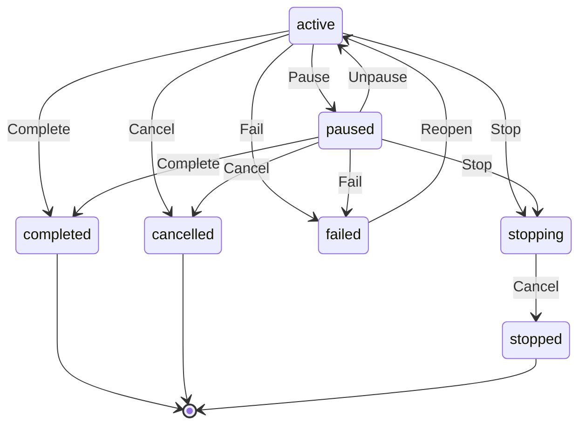

# Quest

Written by `scripts/machines.mjs` from `QuestMachine` in `packages/domain/src/quest.ts`. Do not edit it by hand: change the machine and run `pnpm docs:machines`.

Its state is in the `state` field.

| State | Meaning |
| --- | --- |
| active | Under way: its lead works on it with its party |
| paused | You paused it: no turn starts in it until you resume it |
| stopping | Its lead stopped it at your request; the work under it is being cancelled |
| completed | Its lead said it delivered what you asked for |
| failed | Its Task failed; a retry or another hob reopens it |
| cancelled | You cancelled it |
| stopped | Its lead stopped it at your request, without delivering it |

| Event | From | To | Guarded |
| --- | --- | --- | --- |
| Stop | active, paused | stopping | no |
| Complete | active, paused | completed | no |
| Fail | active, paused | failed | no |
| Cancel | stopping | stopped | no |
| Cancel | active, paused | cancelled | no |
| Pause | active | paused | no |
| Unpause | paused | active | no |
| Reopen | failed | active | no |
