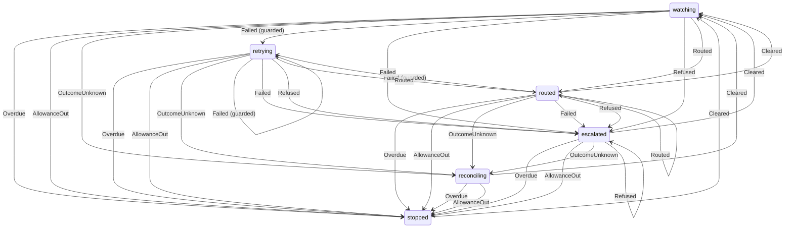

# Supervision

Written by `scripts/machines.mjs` from `SupervisionMachine` in `packages/domain/src/supervision.ts`. Do not edit it by hand: change the machine and run `pnpm docs:machines`.

Its state is in the `state` field.

| State | Meaning |
| --- | --- |
| watching | Nothing needs the supervisor |
| retrying | The supervisor retried a failed turn itself, within its budget |
| routed | A question waited on someone who cannot answer; the supervisor passed it on |
| reconciling | What an Attempt did, or whether it stopped, is not known; nothing restarts it on its own |
| escalated | The supervisor handed a decision to the lead: retries spent, or calls refused again and again |
| stopped | Past its deadline, or out of usage allowance: stopped, and the lead told why |

| Event | From | To | Guarded |
| --- | --- | --- | --- |
| Overdue | watching, retrying, routed, reconciling, escalated | stopped | no |
| AllowanceOut | watching, retrying, routed, reconciling, escalated | stopped | no |
| OutcomeUnknown | watching, retrying, routed, escalated | reconciling | no |
| Failed | watching, retrying, routed | retrying | yes |
| Failed | watching, retrying, routed, escalated | escalated | no |
| Refused | watching, retrying, routed, escalated | escalated | no |
| Routed | watching, retrying, routed | routed | no |
| Cleared | routed, reconciling, escalated, stopped | watching | no |
