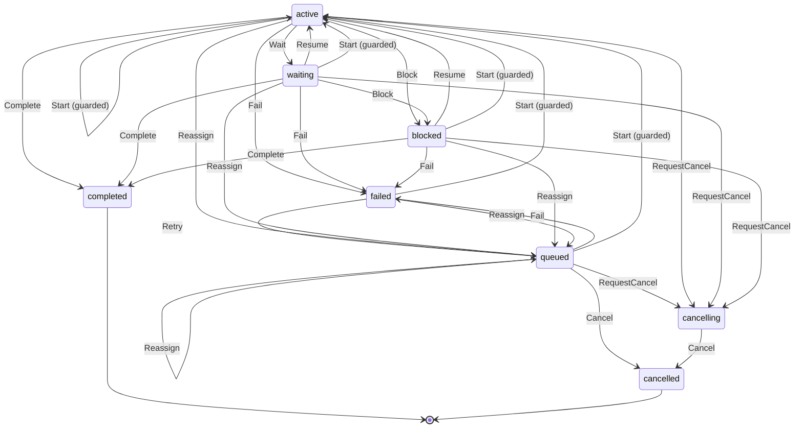

# Task

Written by `scripts/machines.mjs` from `TaskMachine` in `packages/domain/src/task.ts`. Do not edit it by hand: change the machine and run `pnpm docs:machines`.

Its state is in the `state` field.

| State | Meaning |
| --- | --- |
| queued | Waiting for its first Attempt, or for the next one after a retry or reassignment |
| active | An Attempt is running |
| waiting | Waiting on a dependency, an approval or an answer |
| blocked | Waiting for a decision from outside its turn: its lead's, or for a step its owner's |
| cancelling | A cancel was requested and is not confirmed yet |
| completed | Done, with its result |
| failed | Ended without a result; a retry or reassignment reopens it |
| cancelled | Stopped, and the stop is confirmed |

| Event | From | To | Guarded |
| --- | --- | --- | --- |
| Wait | active | waiting | no |
| Block | active, waiting | blocked | no |
| Resume | waiting, blocked | active | no |
| Fail | queued, active, waiting, blocked | failed | no |
| RequestCancel | queued, active, waiting, blocked | cancelling | no |
| Cancel | queued, cancelling | cancelled | no |
| Start | queued, active, waiting, blocked, failed | active | yes |
| Retry | failed | queued | no |
| Reassign | queued, active, waiting, blocked, failed | queued | no |
| Complete | active, waiting, blocked | completed | no |
