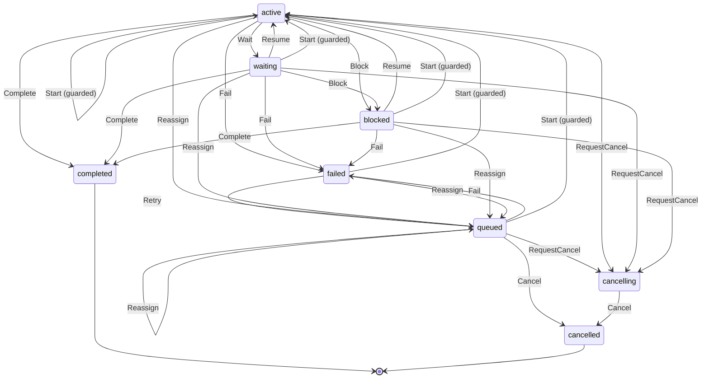

# Task

Written by `scripts/machines.mjs` from `TaskMachine` in `packages/domain/src/task.ts`. Do not edit it by hand: change the machine and run `pnpm docs:machines`.

States, in its `state` field: `queued`, `active`, `waiting`, `blocked`, `cancelling`, `completed`, `failed`, `cancelled`.

| Event | From | To | Guarded |
| --- | --- | --- | --- |
| Wait | active | waiting | no |
| Block | active, waiting | blocked | no |
| Resume | waiting, blocked | active | no |
| Fail | queued, active, waiting, blocked | failed | no |
| RequestCancel | queued, active, waiting, blocked | cancelling | no |
| Cancel | queued, cancelling | cancelled | no |
| Start | queued, active, waiting, blocked, failed | active | yes |
| Retry | failed | queued | no |
| Reassign | queued, active, waiting, blocked, failed | queued | no |
| Complete | active, waiting, blocked | completed | no |
