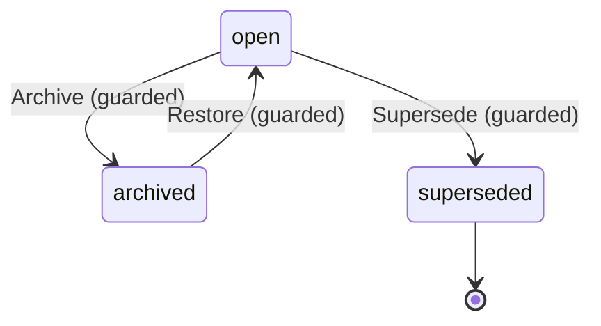

# ThreadLifecycle

Written by `scripts/machines.mjs` from `ThreadLifecycleMachine` in `packages/domain/src/thread.ts`. Do not edit it by hand: change the machine and run `pnpm docs:machines`.

Its state is in the `state` field.

| State | Meaning |
| --- | --- |
| open | Takes messages and turns |
| archived | Left out of thread lists and read-only until restored; search still finds it |
| superseded | A chat that Start fresh replaced with a new one; read-only for good, and search still finds it |

| Event | From | To | Guarded |
| --- | --- | --- | --- |
| Archive | open | archived | yes |
| Restore | archived | open | yes |
| Supersede | open | superseded | yes |
