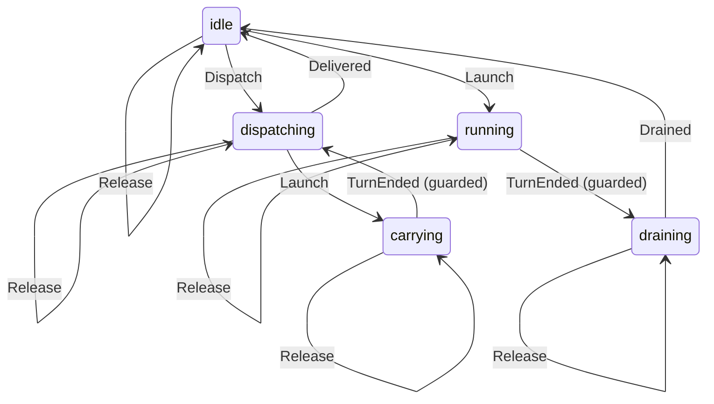

# ThreadRun

Written by `scripts/machines.mjs` from `ThreadRunMachine` in `packages/agents/src/thread-run.ts`. Do not edit it by hand: change the machine and run `pnpm docs:machines`.

Its state is in the `run` field.

| State | Meaning |
| --- | --- |
| idle | No turn runs and nothing is being dispatched; a prompt starts at once |
| dispatching | The dispatcher is putting backpack work into the thread's next turn |
| running | A turn runs, freed by its own drain when it ends |
| carrying | A turn the dispatcher started runs, carrying backpack work |
| draining | The turn has ended and its drain has yet to free the thread |

| Event | From | To | Guarded |
| --- | --- | --- | --- |
| Dispatch | idle | dispatching | no |
| Launch | idle | running | no |
| Launch | dispatching | carrying | no |
| TurnEnded | running | draining | yes |
| TurnEnded | carrying | dispatching | yes |
| Drained | draining | idle | no |
| Drained | idle | idle | no |
| Delivered | dispatching | idle | no |
| WakeLater | dispatching | dispatching | no |
| WakeLater | running | running | no |
| WakeLater | carrying | carrying | no |
| WakeLater | draining | draining | no |
| Choose | idle | idle | no |
| Choose | dispatching | dispatching | no |
| Choose | running | running | no |
| Choose | carrying | carrying | no |
| Choose | draining | draining | no |
| Unchoose | idle | idle | no |
| Unchoose | dispatching | dispatching | no |
| Unchoose | running | running | no |
| Unchoose | carrying | carrying | no |
| Unchoose | draining | draining | no |
| Hold | idle | idle | no |
| Hold | dispatching | dispatching | no |
| Hold | running | running | no |
| Hold | carrying | carrying | no |
| Hold | draining | draining | no |
| Release | idle | idle | no |
| Release | dispatching | dispatching | no |
| Release | running | running | no |
| Release | carrying | carrying | no |
| Release | draining | draining | no |
