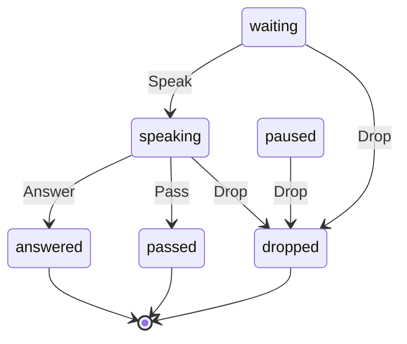

# TurnRequest

Written by `scripts/machines.mjs` from `TurnRequestMachine` in `packages/domain/src/turn-request.ts`. Do not edit it by hand: change the machine and run `pnpm docs:machines`.

Its state is in the `state` field.

| State | Meaning |
| --- | --- |
| waiting | Owed and in line for the floor |
| paused | Past the relay budget: kept, wakes nobody, until a person lets the hobs go on |
| speaking | Its hob holds the floor, in the turn writing its reply |
| answered | The turn that took it ended |
| passed | Its hob ended the turn with no message |
| dropped | Stop or Stop all dropped it, recording who stopped it |

| Event | From | To | Guarded |
| --- | --- | --- | --- |
| Speak | waiting | speaking | no |
| Answer | speaking | answered | no |
| Pass | speaking | passed | no |
| Drop | waiting, paused, speaking | dropped | no |
