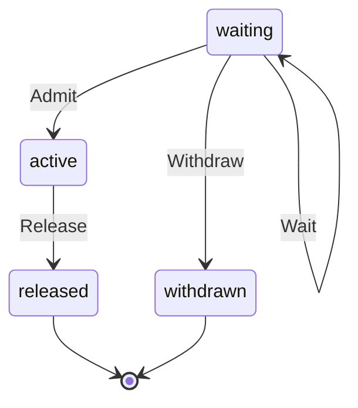

# TurnTicket

Written by `scripts/machines.mjs` from `TurnTicketMachine` in `packages/domain/src/turn-slots.ts`. Do not edit it by hand: change the machine and run `pnpm docs:machines`.

Its state is in the `state` field.

| State | Meaning |
| --- | --- |
| waiting | Past a limit, or behind another Quest's turn; what it starts for stays queued |
| active | Holds a slot: the turn runs |
| released | The turn ended and its slot is free |
| withdrawn | It stopped waiting without a turn |

| Event | From | To | Guarded |
| --- | --- | --- | --- |
| Wait | waiting | waiting | no |
| Admit | waiting | active | no |
| Release | active | released | no |
| Withdraw | waiting | withdrawn | no |
