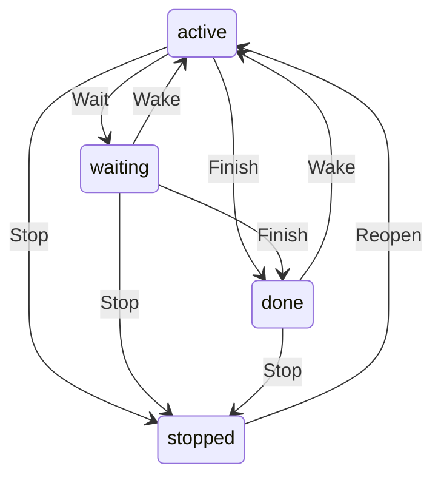

# WorkQuest

Written by `scripts/machines.mjs` from `WorkQuestMachine` in `packages/domain/src/work-quest.ts`. Do not edit it by hand: change the machine and run `pnpm docs:machines`.

Its state is in the `state` field.

| State | Meaning |
| --- | --- |
| active | Someone is working on it, or a reply is owed |
| waiting | Its owner asked the requester something or needs an approval: the card shows Needs you |
| done | Its owner said the Done when lines hold, with a short result |
| stopped | The requester or the camp's owner pressed Stop, or its hob retired at once |

| Event | From | To | Guarded |
| --- | --- | --- | --- |
| Wait | active | waiting | no |
| Wake | waiting, done | active | no |
| Finish | active, waiting | done | no |
| Stop | active, waiting, done | stopped | no |
| Reopen | stopped | active | no |
