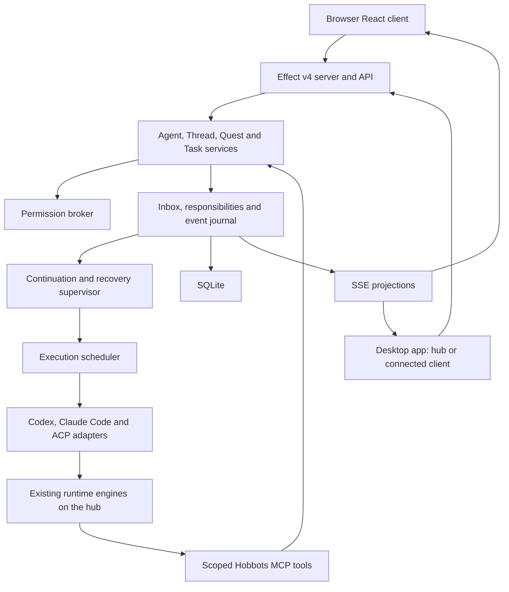

# Architecture overview

**Decided:** TypeScript monorepo, React web UI, Electron desktop shell, Effect TS v4 application server and HTTP API, Effect Schema, typed errors/services/Layers, explicit transitions, Effect SQL integration, SQLite per installation with PostgreSQL-compatible SQL, Effect Stream/SSE, existing runtimes and MCP-backed durable coordination.

## Dependency direction

Domain schemas, identity and transition rules are independent of transport and runtime protocol. Application services enforce policy, validate commands, and persist changes transactionally. Infrastructure implements repositories, adapter connections, process ownership, HTTP/SSE and executor transport. UI reads authoritative projections and submits typed commands.

Use one scheduler, one durable event model, and one lifecycle definition per domain process. Effect fibers and scoped resources handle live concurrency and cleanup. Ordinary Queue/PubSub/Schedule values are not durable jobs. Durable state and recovery determine work after a crash.

Effect Workflow or persistent execution services may implement long waits and resumptions. Keep unstable workflow APIs behind internal interfaces so Quest, Task and Inbox services retain their own domain contracts. Do not make every configuration update or UI panel a Workflow.

## Module map

`apps/web` renders the UI described in the [design specification](../design/ui-ux.md). `apps/desktop` owns Electron lifecycle, the background server service and connection setup. `apps/server` assembles Effect Layers and serves the browser/API. Packages separate domain, API, agents, runtimes, orchestration, inbox, supervision, permissions, execution, workbench and persistence. Packages without code yet contain boundary descriptions only.

The toolchain is recorded in [ADR 009](../decisions/009-toolchain-and-validation-slice.md). Fetch current version-specific documentation before implementation and validate compatible Effect v4 packages together.

## Consistency requirements

Persist task/result state and the obligation to deliver/schedule together, then dispatch after commit. Use an outbox or equivalent transactional durable mechanism. Claim work with ownership/lease fencing and expected versions. A stale worker cannot close a newer attempt. Consumers deduplicate stable event/message identities. Avoid claiming universal exactly-once external effects.

Secrets stay in executor/provider credential storage, not conversation payloads. Authenticate every client device with an approved, revocable token; agent MCP credentials carry narrower orchestration authority. Treat artifact rendering and tool output as untrusted data.
